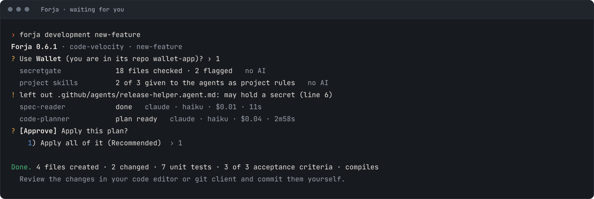
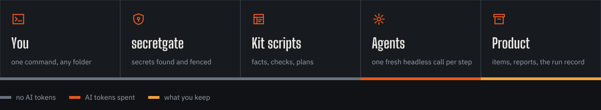

<p align="center">
<picture><source media="(prefers-color-scheme: light)" srcset="docs/assets/readme/hero-day.svg"></picture>
</p>

<p align="center">


</p>

<p align="center"><b><a href="#install">Install</a> · <a href="#update-and-uninstall">Update</a> · <a href="#how-a-run-works">How a run works</a> · <a href="#the-lifecycle">The lifecycle</a> · <a href="#kits-and-skills">Kits and skills</a> · <a href="#safety">Safety</a> · <a href="#commands">Commands</a></b></p>

Forja runs AI kits from one terminal command: understanding a legacy system, requirements, architecture, delivery planning, test preparation and development. You answer the questions; agents do the work in the background with Claude Code, Codex or GitHub Copilot, on your subscription or an API key. Every kit writes into one product, as items each role owns.

> 0.7.0 is an experimental release: Forja installed with brew, curl or PowerShell, compiled, with its prompts encrypted.

## Install

| Computer | Command |
|---|---|
| macOS or Linux, brew | `brew tap Omara8/forja https://github.com/Omara8/Forja && brew install forja` |
| macOS or Linux, curl | `curl -fsSL https://raw.githubusercontent.com/Omara8/Forja/main/install.sh \| sh` |
| Windows, PowerShell | `irm https://raw.githubusercontent.com/Omara8/Forja/main/install.ps1 \| iex` |

Then type `forja`. The first run sets up this computer: where your archive goes and which AI tools to use (`forja setup` runs it again).

| You need | |
|---|---|
| One AI tool, signed in | `claude`, `codex` or `copilot` |
| Nothing else | Forja brings its own Python 3.13 |

| Where | What |
|---|---|
| `~/forja` (macOS, curl) · `/opt/forja` (Linux, curl) · `%USERPROFILE%\forja` (Windows) · brew's own folder (brew) | Forja itself: `bin/` (the command), `python/`, `app/` |
| `~/forja/config` | Your settings, kept on every update |
| `Desktop/Forja-Archive` by default, never a synced folder | Your products, runs and this computer's caches |

Nothing is installed in a hidden folder, except brew's own on Linux (`/home/linuxbrew/.linuxbrew`). Every download is checked against its SHA-256 before anything is replaced. More: [installing, updating, uninstalling](docs/installing.md).

## Update and uninstall

| | brew | curl or PowerShell |
|---|---|---|
| Update | `brew upgrade forja` | Run the install command again |
| From Forja | `forja upgrade` | `forja upgrade` |
| Uninstall | `forja uninstall`, then `brew uninstall forja` | `forja uninstall` |

An update keeps your settings, archive and products. Uninstall asks whether to keep the archive.

<picture><source media="(prefers-color-scheme: light)" srcset="docs/assets/readme/terminal-day.svg"></picture>

## How a run works

<picture><source media="(prefers-color-scheme: light)" srcset="docs/assets/readme/runflow-day.svg"></picture>

| | |
|---|---|
| **One fresh call per step** | Each agent gets only the files it needs, no shell, no web, and ends; nothing carries over |
| **Agents answer, Forja writes** | An agent returns its items as one answer; Forja checks the skill's write rights, gives the ids, resolves the references and writes the files |
| **You decide** | Drafts are shown for review; writing skills show their plan first: all of it, part of it, or ask for changes |
| **Nothing assumed** | No technical question has a default. Each shows the recommended option with its reason; you choose |
| **One way to answer** | Pick by number; every choice ends with Other (type your own): the answer interpreter reads your words against everything answered so far and asks a follow-up until the answer is solid. `?` explains any question; `!` at a technical question recommends one to three choices for this product (you still choose); `+` explains the requirement items a question must meet |
| **Document library** | A new run first asks for the product's documents (requirements, designs, screenshots, exports): read once, secrets removed first; each later question they answer shows the quote and the file, for you to confirm or edit |
| **Exit any time** | Every numbered question ends with Exit (saved); `forja resume` continues at the same question |
| **Runs named by ticket** | A run's name is how resume and reports find it (`ABC-200`) |

More: [running Forja](docs/running.md).

## The lifecycle

| Stage | Kit | Command | Roles | Approves |
|---|---|---|---|---|
| Understand the existing system | code-insight | `forja insight` | product owner, business analyst, architect | Reports; drafts for requirements and architecture |
| Requirements | scope-clarity | `forja requirements` | product owner, business analyst | review-requirements: APPROVED-SCOPE.md |
| Architecture | architecture-blueprint | `forja architecture` | architect, platform lead | review-architecture: HIGH-LEVEL-DESIGN.md, DESIGN-MAP.html |
| Planning | delivery-cadence | `forja planning` | tech lead, product owner | plan-iterations: the plan, a CSV for Jira |
| Test plan | test-readiness | `forja test-plan` | quality assurance | review-test-coverage: TEST-PLAN.md, COVERAGE.md |
| Development | code-velocity | `forja development` | developer | A story is marked built only when it compiles and its tests pass |

Stages run in order by default; starting a later one early is allowed, and what it relies on from an unapproved stage is tracked. More: [the lifecycle](docs/lifecycle.md).

## Products and items

| | |
|---|---|
| **Product** | Everything about one piece of software, one repo or ten: its items, platforms and repos. Start a run asks whether the product is already in your Forja Archive; if not, the path of its code adds it |
| **Repos by name** | A product knows each repo by name; each computer keeps its own folder for it in `_local/paths.json`, never in the product |
| **Items** | One file per item: `<stage>/<type>/<id>.md`, 30 types (business-rule, decision, contract, story, test-scenario …). Ids are full words, never padded: `business-rule-12`, `story-3` |
| **Versions** | Every item has a version and a status (draft, approved). References name a version: `decision-4@2`. Older versions are kept in `_versions/`; each change adds a line under `## Revisions` |
| **Owners** | Each skill may write only the item types the skill map gives it; a field-limited right changes only those fields (development updates a story's progress, never its text) |
| **Generated documents** | APPROVED-SCOPE.md, HIGH-LEVEL-DESIGN.md, the plan, TEST-PLAN.md and the others are built from the items; the items are the source |
| **Sharing** | A team shares a product by putting its folder in a synced folder; teammates join it from Products with nothing retyped |

## Approvals and change requests

| | |
|---|---|
| **Stage approval** | Four steps: Forja's checks, a simulation of the stage's items read together, a decision per finding (fix the draft, raise an open question, accept with a reason), then every item frozen at its version together |
| **Change an earlier answer** | `forja <kit> change-answer`: a checked edit of an item your kit owns: applied at once when a sanity check finds nothing it breaks; otherwise refused, with what it would break, and nothing changes |
| **Change request** | Asking another role to change its item. Simulated across the product on a copy. States: waiting, declined, in review, applied, withdrawn. When nothing breaks, the owner uses it, refuses it with a reason, or takes it offline |
| **Offline review** | The team's meeting for a disputed or declined change request; the only place a change the simulation declined can still be applied. The diagnosis and decision are recorded with the role |
| **Outdated work** | Code built from an item version that has changed since is flagged: rebuild, keep or take it offline |
| **Open questions** | Raised for the role who knows; a stage's approval waits while its own roles' questions are open |
| **Roles, never names** | Every decision is recorded by role (product owner, architect, quality assurance …), never by person |

`forja approvals` lists everything waiting for you.

## Kits and skills

<!-- forja:kits -->
Forja is the tool. Each kit does one part of delivery and holds skills; a skill runs agents (AI) and scripts (no AI). Every skill runs the same way: `forja <command> <skill>`. 6 kits, 36 skills. One install brings all of them: [Install](#install).

| | Kit | Command | For | Skills |
|---|---|---|---|---|
|  | **code-insight** | `forja insight` | Understanding legacy code and planning its rebuild | 4 |
|  | **scope-clarity** | `forja requirements` | Requirements: needs, scope, acceptance criteria, sign-off | 5 |
|  | **architecture-blueprint** | `forja architecture` | Architecture across every stack | 9 |
|  | **delivery-cadence** | `forja planning` | Planning delivery: one plan, each story in the repo that builds it | 4 |
|  | **test-readiness** | `forja test-plan` | Test preparation: plan, cases, coverage, data, automation | 5 |
|  | **code-velocity** | `forja development` | Writing, testing and reviewing code | 9 |

<details open>
<summary> <b>code-insight</b> · <code>forja insight</code> · 4 skills<br><sub>Understand legacy code and plan its rebuild, with every claim traced to a file.</sub></summary>

| Skill | What it does |
|---|---|
| `feature-report` | One feature from the code: flows, possible bugs, the items it confirms |
| `explain-code` | One file, method or class explained |
| `architecture-report` | The existing system's structure → ARCHITECTURE.md and architecture items |
| `modernize` | The legacy scope → requirements items and decisions on dead code and legacy bugs |

</details>

<details>
<summary> <b>scope-clarity</b> · <code>forja requirements</code> · 5 skills<br><sub>Turn what stakeholders need into an approved scope, feature by feature, in business language.</sub></summary>

| Skill | What it does |
|---|---|
| `elicit-requirements` | Documents + your answers → needs, goals, scale and success measures |
| `define-scope` | Needs → scope items, flows, business rules, what is out |
| `analyze-requirements` | Gaps, duplicates, conflicts, ambiguities; a priority per scope item |
| `define-acceptance-criteria` | Given / When / Then for every flow outcome and rule |
| `review-requirements` | Read-back, sign-off, stage approval → APPROVED-SCOPE.md |

</details>

<details>
<summary> <b>architecture-blueprint</b> · <code>forja architecture</code> · 9 skills<br><sub>Design the whole product before it is built: one high-level design, one section per stack, every conflict answered.</sub></summary>

| Skill | What it does |
|---|---|
| `technical-intake` | Constraints, non-functional requirements, stacks, outside systems and data |
| `evaluate-options` | Two or three ways to build it; you choose one |
| `high-level-design` | Components with what they serve, decisions, the overview |
| `define-contracts` | Contracts, data entities, foundations, measurable requirements |
| `design-sections` | One section per platform: modules and proposed decisions |
| `review-architecture` | Design review and stage approval → HIGH-LEVEL-DESIGN.md |
| `architecture-map` | DESIGN-MAP.html from the items |
| `architecture-section` | Design one section from a bundle someone sent you |
| `architecture-merge` | Bring a returned section bundle back |

</details>

<details>
<summary> <b>delivery-cadence</b> · <code>forja planning</code> · 4 skills<br><sub>Turn an approved scope and an architecture into one plan for the product: each platform plans only what it builds.</sub></summary>

| Skill | What it does |
|---|---|
| `decompose-work` | Features, epics and stories from the requirements and architecture |
| `estimate-delivery` | Story points against your reference story; the team's capacity |
| `map-dependencies` | Build order and dependencies; what the code already has |
| `plan-iterations` | Increments by capacity, the planning approval, the Jira CSV |

</details>

<details>
<summary> <b>test-readiness</b> · <code>forja test-plan</code> · 5 skills<br><sub>Prepare every test before development: the plan, the cases, coverage, test data per environment and the automated tests.</sub></summary>

| Skill | What it does |
|---|---|
| `plan-testing` | Test strategy, environments, one tool per stack and level |
| `create-test-cases` | Quality assurance's scenarios per acceptance criterion: automated or manual, at its levels |
| `review-test-coverage` | Coverage of criteria and stories, then the test plan approval → COVERAGE.md |
| `prepare-test-resources` | Each environment's rules, then made-up test data (never production) |
| `build-test-automation` | Quality assurance's automated tests, written into the automation repo |

</details>

<details>
<summary> <b>code-velocity</b> · <code>forja development</code> · 9 skills<br><sub>Build, test, fix, document and review code the way your project already does it.</sub></summary>

| Skill | What it does |
|---|---|
| `new-feature` | Build a feature like the closest existing one, with unit tests |
| `change-feature` | Change a feature: who uses it and which contracts change, first |
| `add-foundation` | A reusable piece built on what exists |
| `refactor` | Behaviour pinned by tests, then ordered refactor steps |
| `write-tests` | Tests for a story, a feature, a class or your current changes |
| `improve-coverage` | Coverage up where it matters, measured like SonarQube, before → after |
| `fix-bug` | Ranked causes, you confirm one, then the fix and a test |
| `write-docs` | High-level and low-level design documentation with diagrams, checked against the code |
| `review-code` | Review a branch before the pull request (never changes code) |

</details>
<!-- /forja:kits -->

## Safety

| Rule | What it means |
|---|---|
| Secrets never reach the AI | Git-ignored and secret files (`.env`, keys, keystores, `google-services.json`, `local.properties`) are never read, and no secret value is ever printed. A file that holds a secret is never changed: it becomes a manual step for you |
| No git | Forja never creates branches, commits or pushes. You review the changes and commit them with your own tools |
| Your project's way wins | Skills follow the project's existing style, its own AI skills and agents, and the standing rules your team set. More: [what Forja remembers](docs/memory.md) |
| Agents are fenced | They write only what their run allows: the four item kits' agents only in the product's folder and their run's folder, and never run commands; code agents only the repo files of an approved plan. Guards fail closed: if one cannot decide, the read or write is refused |
| Your data stays yours | No server, no account, no telemetry |
| Forja's own code | Compiled to native modules, its prompts encrypted; IT teams get a SHA-256 list of every file (`app/IT-NOTE.md`) |

## Commands

```text
forja                                  menu: start a run · resume · runs in progress · show a report · products · approvals and change requests · saved answers · doctor
forja <kit>                            a kit's skills (insight, requirements, architecture, planning, test-plan, development)
forja <kit> <skill>                    start a skill
      --product <name>                 which product (skips the question)
      --repo <name>                    which repo of the product
      --name <run>                     the run's name (a ticket number is best)
      --tool claude|codex|copilot      the AI tool for this run (default: the one set at install)
      --parallel N                     agents at once (default 3)
forja <kit> change-answer              change an earlier answer: a checked edit of one item
forja resume [run]                     continue a stopped run
forja status                           runs in progress and where each one waits
forja show <run>                       a run's report, in the pager
forja products [add [folder] | move | forget | import]   the products this computer knows
forja repos path                       a repo's folder on this computer
forja approvals                        stage approvals, change requests, open questions, outdated work
forja report                           the product report (PRODUCT-REPORT.md): every kit and skill, every question and answer
forja report --kit <kit>               one kit's report (reports/KIT-<kit>.md): its skills, its stage, what comes next
forja report --skill <skill>           one skill's report (reports/SKILL-<skill>.md): every run of it
forja doctor                           Python, AI tools, sign-in, hooks and file fingerprints
forja version                          the installed version
forja setup                            set up this computer again: the archive, the AI tools, the hooks
forja upgrade                          update Forja the way it was installed (brew, curl or PowerShell)
forja uninstall                        remove Forja; asks whether to keep the archive
```

Which model each agent uses: [models](docs/models.md).

<p align="center"><picture><source media="(prefers-color-scheme: light)" srcset="docs/assets/readme/heatband-day.svg"></picture></p>

<p align="center"><picture><source media="(prefers-color-scheme: light)" srcset="docs/assets/readme/mark-day.svg"></picture><br><sub>Proprietary license · nothing leaves your machine except your AI tool's own calls</sub></p>
