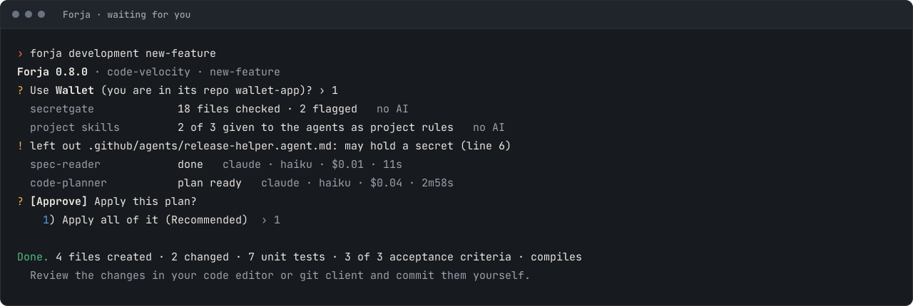
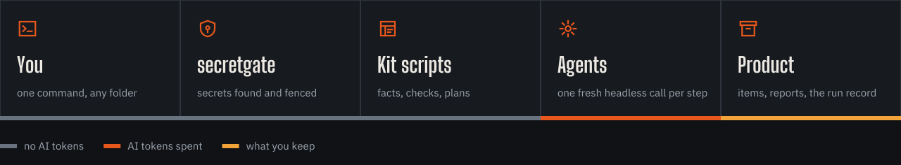

<p align="center">
<picture><source media="(prefers-color-scheme: light)" srcset="docs/assets/readme/hero-day.svg"></picture>
</p>

<p align="center">


</p>

<p align="center"><b><a href="#install">Install</a> · <a href="#update-and-uninstall">Update</a> · <a href="#the-desktop-app">The desktop app</a> · <a href="#how-a-run-works">How a run works</a> · <a href="#the-lifecycle">The lifecycle</a> · <a href="#kits-and-skills">Kits and skills</a> · <a href="#safety">Safety</a> · <a href="#commands">Commands</a></b></p>

Forja runs AI kits from one desktop app: understanding a legacy system, requirements, architecture, delivery planning, test preparation and development. Each product is worked from its dashboard: what needs you, the areas you can work in, the questions to answer, what to review and what is ready to build. You answer the questions; agents do the work in the background with Claude Code, Codex or GitHub Copilot, on your subscription or an API key. Every kit writes into one product: tickets for the work, objects for every fact, each field owned by one role. Secrets and hidden AI instructions are stopped before any agent reads a thing, and every agent is fenced to its own step. Forja runs on one computer, offline.

> 0.7.x is an experimental line: Forja installed with brew, curl or PowerShell, compiled, with its prompts encrypted.

## Install

| Computer | Command |
|---|---|
| macOS or Linux, brew | `brew tap Omara8/forja https://github.com/Omara8/Forja && brew install omara8/forja/forja` |
| macOS or Linux, curl | `curl -fsSL https://github.com/Omara8/Forja/releases/latest/download/install.sh \| sh` |
| Windows, PowerShell | `irm https://github.com/Omara8/Forja/releases/latest/download/install.ps1 \| iex` |

The commands above install the `forja` command (for the terminal, scripts and CI). The installers are files of each release (the
commands take the newest one). The desktop app, the main way to use Forja, is a separate download from the
[latest release](https://github.com/Omara8/Forja/releases/latest), with Forja's engine inside it:

| Computer | Desktop app file |
|---|---|
| macOS, Apple Silicon (M1 or newer) | `.dmg` |
| Windows (x64) | `.msi`, or the setup `.exe` (installs for your user only) |
| Linux (x64) | `.AppImage`, or `.deb` |

Forja is built on free tiers only, so the macOS and Windows apps are not signed by Apple or Microsoft (every release file is
signed with Sigstore instead). The first launch asks once:

| Computer | First launch |
|---|---|
| macOS | Open Forja from Applications. macOS says it cannot check the developer: open System Settings → Privacy & Security, scroll to the message about Forja and choose Open Anyway, then confirm. If macOS says Forja "is damaged", type `xattr -dr com.apple.quarantine /Applications/Forja.app` in Terminal once, then open it again |
| Windows | SmartScreen shows "Windows protected your PC" with an unknown publisher: choose More info, then Run anyway |
| Linux | An `.AppImage` needs to be made runnable once: `chmod +x` followed by its full path |

macOS: Apple Silicon only. An Intel Mac stays on Forja 0.9.0: the installers, brew and `forja upgrade` stop with "Forja needs an
Apple Silicon Mac (M1 or newer)." and change nothing.

For the terminal, type `forja`. The first run sets up this computer: where your archive goes and which AI tools to use (`forja setup` runs it again).

| You need | |
|---|---|
| One AI tool, signed in | `claude`, `codex` or `copilot` |
| Nothing else | Forja brings its own Python 3.13 |

| Where | What |
|---|---|
| `~/forja` (macOS, curl) · `/opt/forja` (Linux, curl) · `%USERPROFILE%\forja` (Windows) · brew's own folder (brew) | Forja itself: `bin/` (the command), `python/`, `app/` |
| `~/forja/config` | Your settings, kept on every update |
| `Desktop/Forja-Archive` by default, on this computer | Your products, runs and this computer's caches. Uninstalling never deletes them |

Nothing is installed in a hidden folder, except brew's own on Linux (`/home/linuxbrew/.linuxbrew`). Every download is checked before anything is replaced: its Sigstore signature when [cosign](https://docs.sigstore.dev) is installed (signed by Forja's release workflow), else its SHA-256, with a warning that the signature was not checked. More: [installing, updating, uninstalling](docs/installing.md).

## Update and uninstall

| | brew | curl or PowerShell |
|---|---|---|
| Update | `brew upgrade omara8/forja/forja` | Run the install command again |
| From Forja | `forja upgrade` | `forja upgrade` |
| Uninstall | `forja uninstall`, then `brew uninstall omara8/forja/forja` | `forja uninstall` |

An update keeps your settings, archive and products. Products made before 0.7.3 are moved whole, untouched, into `<archive>/legacy/<date>/`. Uninstalling never deletes the archive or the products.

<picture><source media="(prefers-color-scheme: light)" srcset="docs/assets/readme/terminal-day.svg"></picture>

## The desktop app

The app is how Forja is used: every skill and every one of Forja's own jobs (a group check, a stage approval, a change) runs in
the engine it starts, and the app shows each job, its questions and its output. While a job writes a product, everything else can
only read it.

| Screen | What it shows |
|---|---|
| **Home** | Every product on this computer (type, Forja version, platforms, ticket key, busy or idle), what is being worked on, and what waits for you |
| **New product** | One page: new product or existing software, where its code is, its name and ticket key, its platforms and their repositories |
| **A product's dashboard** | Needs you (chips: clashes, offline reviews, sign-offs, open questions, and tickets needing details, off by default), Areas with their gates, To answer, To review, Being worked, Ready to build, Recently changed. Every open item shows in one section only |
| **Questions** | A skill's questions in groups, one group on one page; the group is checked before anything is written |
| **Ticket form** | A ticket as in Jira: id, type and status required; links to tickets this product does not have yet become placeholders |
| **Guide** | What Forja can do, read from the code: the kits and their skills, when each area opens for each product type, and four paths (a new idea, MVP or PoC; an existing product straight to development; an existing product straight to a test plan; legacy code understood first). With a product open, which of its areas are open now |
| **Ask about this product** | A side panel: a question about the open product, answered by Forja-Agent from its items, what its documents say and its code, with the item ids cited (0.11.0); × closes it. An item opens on the product page's details screen |
| **Jobs and the Log** | Every piece of work is a job in the product's job log; one log on this computer holds the technical detail, with secrets removed |
| **Settings** | Forja's own: AI tools (the tools found, the one in use, the model for light, normal and heavy work, limits), Storage (the products folder, Import, products in the folder not added yet), Safety (the guards, on or off; secrets always on; hooks in your AI tools Forja did not write), About (version, update check). Each product has its own Settings under it in the menu: ticket key, type, repositories, Export, Delete |

| Product type | Areas |
|---|---|
| **New product (MVP / PoC / Fresh Idea)** | Gated: requirements always; code insight once it has a repository; architecture once the scope is approved (or code insight finished); planning once the architecture is fully approved; test readiness and development once at least one plan item (feature, epic or story) is approved; Ready to build lists approved stories only |
| **Existing or live** | Every area open. Work done there fills the earlier stages it implies (a ticket's feature, the need it serves, the components it touches) as items marked not approved yet, waiting under Sign-offs |

A closed area says why. More: [the desktop app](docs/desktop-app.md).

## Reviews, approvals and changes

| | |
|---|---|
| **Review** | Each stage's review skill runs the stage-reviewer over every live item of the stage: findings (gap, conflict, duplicate, coverage, quality), each open, settled or closed. Minor findings go into the tickets they are about; blockers and majors get one fix round, and what it does not settle goes to a numbered offline review (0.9.0) |
| **No longer needed** | After the review, Forja lists the items nothing needs any more (all their links point at retired, cancelled, discarded, replaced or out-of-scope items, or a criterion, flow or scenario points at nothing). The approving role keeps or cancels them one by one, or cancels them all |
| **Approval** | The approving role approves the stage: the approval freezes only what the review read, each item at its version (requirements also keep the product owner's mark per item). Approving without a review is refused; "Not yet" puts the items back to draft. Requirements written from a modernize report need the sign-off of both the product owner and the tech lead. States: draft, in review, approved. An approved object is never overwritten |
| **Changing approved work** | One person decides, on the spot (0.11.0). A change to approved work (Change item, or a job that needs one) is tried on a throw-away copy, with everything that relies on it, and shown as a short summary: each field old → new, and what it touches. You accept (recorded as a decision; the stage stays approved) or refuse. When the copy breaks something, you may accept and settle each broken item in your own words; nothing is written until the whole chain checks clean. A ticket already In Progress is replaced by a change ticket (label `change`, link `replaces`); a Done ticket stays Done |
| **Edit a draft** | A draft item is edited directly from its details screen (Edit): no AI, the same checks as any write |
| **Bugs** | Never frozen: a bug can be edited or cancelled at any time |
| **Offline review** | What one fix round could not settle, decided by people: `offline-review-<n>`, every point most severe first, every detail in `offline-review-<n>.md` in the product's cache; answered in the app's Offline reviews with one block of text (a paragraph, or `1- … / 2- …`); Forja applies it once |
| **Open questions** | Raised for the role that knows. States: open, in review, done, paused, stale (what it asks about changed), cancelled |
| **Roles as labels** | Every decision is labelled with the hat it was taken in (product owner, tech lead, delivery lead, QA lead, `<platform>` developer), never a person's name |

The dashboard's Needs you lists everything waiting for you.

## How a run works

<picture><source media="(prefers-color-scheme: light)" srcset="docs/assets/readme/runflow-day.svg"></picture>

| | |
|---|---|
| **One fresh call per step** | Each agent gets only the files it needs, no shell, no web, and ends; nothing carries over |
| **Agents answer, Forja writes** | A writing agent never writes the product. It gets its own sandbox in the run and writes one JSON file per item there: `sandbox-business-rule-1.json` for a new item (its links name its other new items by those sandbox names, existing items by their real ids), `changes/flow-3.json` for a change to an existing item, then `DONE.json` last. When the agent stops, Forja takes its sandbox in turn (first come, first served): it gives each new item its real id, rewrites the links, writes the whole set through the write gateway, all or nothing, and clears the sandbox. A sandbox that touches what an earlier one just wrote is checked again by its agent. Every change is first applied to a throw-away copy of the product and checked there (0.9.0). One that is refused or would break the product gets one fix round (the same agent, from an empty sandbox, told why), then an offline review whose answers go to the agent once; nothing loops and the run never stops without saying why. Review agents return their findings in a JSON file |
| **You decide** | Drafts are shown for review; writing skills show their plan first: all of it, part of it, or ask for changes |
| **Nothing assumed** | No technical question has a default. Each shows the recommended option with its reason; you choose |
| **One way to answer** | Pick an option; every choice has Other (type your own): the answer interpreter reads your words against everything answered so far and asks a follow-up until the answer is solid. Every question has its explanation; at a technical question, Recommend an answer gives one to three choices for this product (you still choose), and What the requirements say explains the requirement objects a question must meet |
| **Document library** | A new run first asks for the product's documents (requirements, designs, screenshots, exports): read once, secrets removed first; each later question they answer shows the quote and the file, for you to confirm or edit |
| **Leave any time** | A job that asks waits for you under Being worked (the dashboard and the title bar) and continues at the same question, even after the app is closed and opened again; Stop ends it and undoes what it half wrote |
| **Jobs** | Every piece of work (a skill, a group check, an approval, a migration) is a job, numbered per product and never reused (`job-12`). The product's job log (`work/jobs.jsonl`) keeps one line per job that ended: what ran, how it ended and why. A job's record keeps every question with its raw answer, the versions it read and what it produced (`runs/<id>/`). Working files live in `_local/tmp/` and go when the job ends |

More: [running Forja](docs/running.md).

## The lifecycle

| Stage | Kit | Approving role | Review skill: what it approves |
|---|---|---|---|
| Understand the existing system | code-insight | none | Writes reports only (`repos/<repo>/insight/`); owns no object |
| Requirements | scope-clarity | product owner | review-requirements: APPROVED-SCOPE.md |
| Architecture | architecture-blueprint | tech lead | review-architecture: HIGH-LEVEL-DESIGN.md, DESIGN-MAP.html |
| Planning | delivery-cadence | delivery lead | planning-check: PLAN.md and the Jira tickets |
| Test plan | test-readiness | QA lead | review-test-coverage: TEST-PLAN.md, COVERAGE.md |
| Development | code-velocity | `<platform>` developer | None: tickets move through their workflow (Backlog → To Do → In Progress → Done) |

Two product types, chosen when the product is added and changed later in Settings. **A new product (MVP / PoC / Fresh Idea)** opens its areas through gates, and there is no "start anyway": requirements start any time; code insight once the product has a repository; architecture once the scope is approved (the requirements, or every define-scope item) or a code-insight job finished, and while the requirements stage itself is not approved Forja offers to wait for it; planning once the architecture is fully approved; the test plan and development once at least one plan item (feature, epic or story) is approved. **An existing or live product** (code your team already has): every area is open, there are no stage approvals, and the dashboard offers code-insight (it reverse-engineers the whole codebase: time and AI usage) or development straight away. A ticket you enter there (the ticket form, or a Jira ticket you paste) becomes that same ticket type, and the feature, need and components it implies are filled in as items not approved yet, waiting under Sign-offs. Each kit's skills and the role each skill acts for are in its README. More: [the lifecycle](docs/lifecycle.md).

## Products, tickets and objects

| | |
|---|---|
| **Product** | Everything about one piece of software, one repository or ten. It lives in one folder on this computer (`Forja-Archive/<product>/` by default) |
| **Repositories by name** | A product knows each repository by name; this computer keeps its folder in `_local/paths.json`, never in the product |
| **Objects** | Every fact: `objects/<type>/<id>.json` (need, scope-item, business-rule, component, contract, test-scenario …). Ids are the type's prefix and a number, never padded: rule-12, criterion-7 |
| **Tickets** | The Jira work: `tickets/<type>/<id>.md` (feature, epic, story, task, sub-task, bug, spike). A JSON block, the prose, then generated previews of what the ticket references. One number sequence for all of them, named with the product's ticket key when it has one (CLF-12, asked when the product is added, skippable, changed from the product's menu: every ticket id is renamed and the old ids keep working) |
| **Consistency check** | Plain code, after every skill and before every approval: blocker, major and minor clashes. Minor points go into the tickets they are about (Review notes); blockers and majors get one fix round, each change tried on a throw-away copy of the product first; what is left becomes an offline review |
| **Versions** | A content change makes a new version; the old one is kept in `_versions/`. A state change makes none. Each ticket and object has a version log (`<type>/_versions/<id>.log.json`): one line per content version with its time, run and cause. Items carry no run or cause field |
| **Ownership** | `ownership.json` gives every field one owner. The write gateway checks every change against it |
| **Write gateway** | The one function every write goes through. It checks the model (who may write which field, allowed status moves, field shapes, links), writes all or nothing, and adds a line to each changed item's version log |
| **Platforms** | A product always has at least one platform: creating one without any is refused, and opening one without any asks for them first |
| **Generated documents** | `generated-documents/`: SCOPE-DRAFT.md, APPROVED-SCOPE.md, HIGH-LEVEL-DESIGN.md, PLAN.md, TEST-PLAN.md, COVERAGE.md and the reports, rebuilt from the objects and tickets; never read back |
| **On open** | Opening a product checks its version (migrating it when needed: the app shows the steps and their time first), checks every file against the model (a file that breaks it is listed as a warning: the product still opens, and skills skip that item until you fix it by hand), marks stale questions, rebuilds previews, clears temporary folders a crash left, stops jobs whose process is gone, and says when the other front end is writing it |
| **Products before 0.7.3** | Moved whole, untouched, into `<archive>/legacy/<date>/` on install, on update and by `forja migrate`. One kept outside the archive is only forgotten by this computer; its folder stays where it is |
| **Product type** | `product.json` `product_type`: new (gated areas, stage approvals) or existing (every area open, reverse-filled items to sign off). Set when the product is added; changed in the product's Settings in the app. A migrated product shows its type once on first open for you to confirm |
| **Export and import** | No sync. Export (the product's Settings) writes one zip file (`<name>.forja`) holding the product's record, its documents and reports; never your code, this computer's repository paths, settings or AI accounts, nor the library cache (rebuilt). An import takes that file or a product folder in two steps: Forja first reads it and shows what it holds, what the gate found (text written for an AI, shown before anything is added) and which files it will build again; nothing is added until you say so. Pages, reports and generated documents are never taken from the file: they are rebuilt from the imported data. Import (Settings → Storage) of a product this computer already has updates it: everything new or newer in the file is taken; an item newer here refuses it. An import refuses any path outside the product folder, links, files over 50 MB (100 MB in all) and items that break the model; an older product migrates when you open it. The product stays marked as from outside until you mark it reviewed |
| **Delete** | The product's Settings → Delete…: Remove only (Forja forgets it; its folder stays) or Delete all (its folder and Forja's data for it are deleted). Uninstalling Forja never deletes products |

## Reviews, approvals and change requests

| | |
|---|---|
| **Review** | Each stage's review skill runs the stage-reviewer over every live item of the stage: findings (gap, conflict, duplicate, coverage, quality), each open, settled or closed. Minor findings go into the tickets they are about; blockers and majors get one fix round, and what it does not settle goes to a numbered offline review (0.9.0) |
| **No longer needed** | After the review, Forja lists the items nothing needs any more (all their links point at retired, cancelled, discarded, replaced or out-of-scope items, or a criterion, flow or scenario points at nothing). The approving role keeps or cancels them one by one, or cancels them all |
| **Approval** | The approving role approves the stage: the approval freezes only what the review read, each item at its version (requirements also keep the product owner's mark per item). Approving without a review is refused; "Not yet" puts the items back to draft. Requirements written from a modernize report need the sign-off of both the product owner and the tech lead. States: draft, in review, approved. An approved object is never overwritten |
| **Changing approved work** | When nothing built from it has started (neither it nor anything under it is In Progress or Done: feature > epic > story > sub-task, or for a requirement object the tickets built from it), Forja simulates the change and shows a short summary: each field old → new, and what it touches. You accept (a new version; the stage stays approved) or refuse. When work has started, it is a change request |
| **Change an item** | From the item's panel: an item of a role you hold is changed in one step (checked on a throw-away copy first, then recorded as a decision); an item of another person's role gets a change request. The roles you hold in a product are set in its Settings (all of them by default) |
| **Change request** | Asking another person's role to change their approved work that has started. Simulated on a copy of the product. Once accepted, it creates a new change ticket (label `change`, link `replaces` to the old ticket) in the Backlog for the next sprint; an old ticket still In Progress is cancelled (Done, resolution `cancelled`); a Done ticket stays Done. Everything an accepted change creates counts as approved. States: raised, simulated, applied, declined, in offline review, withdrawn. Sync, on the request's page, shows what changed since it was raised and offers to update it or close it if it was fixed on its own |
| **Bugs** | Never frozen: a bug can be edited or cancelled at any time |
| **Offline review** | What one fix round could not settle, decided by people: `offline-review-<n>`, every point most severe first, every detail in `offline-review-<n>.md` in the product's cache; answered in the app's Offline reviews with one block of text (a paragraph, or `1- … / 2- …`); Forja applies it once |
| **Open questions** | Raised for the role who knows. States: open, in review, done, paused, stale (what it asks about changed), cancelled |
| **Roles, never names** | Every decision is recorded by role (product owner, tech lead, delivery lead, QA lead, `<platform>` developer), never by person |

The dashboard's Needs you lists everything waiting for you.

## Kits and skills

<!-- forja:kits -->
Forja is the tool. Each kit does one part of delivery and holds skills; a skill runs agents (AI) and scripts (no AI). Every skill runs the same way: from the Forja app, as a job you can follow, answer and stop. 6 kits, 39 skills, 67 agents. One install brings all of them: [Install](#install).

| | Kit | For | Skills |
|---|---|---|---|
|  | **code-insight** | Understanding legacy code and planning its rebuild | 4 |
|  | **scope-clarity** | Requirements: needs, scope, acceptance criteria, sign-off | 7 |
|  | **architecture-blueprint** | Architecture across every stack | 8 |
|  | **delivery-cadence** | Planning delivery: one plan, each story in the repository that builds it | 6 |
|  | **test-readiness** | Test preparation: plan, cases, coverage, data, automation | 5 |
|  | **code-velocity** | Writing, testing and reviewing code | 9 |

<details open>
<summary> <b>code-insight</b> · 4 skills<br><sub>Understand legacy code and plan its rebuild, with every claim traced to a file.</sub></summary>

| Skill | What it does |
|---|---|
| `feature-report` | One feature from the code: what it does, its flows, possible bugs, the items it confirms |
| `explain-code` | One file, method or class explained |
| `architecture-report` | The existing system's structure: ARCHITECTURE.md and DIAGRAMS.html |
| `modernize` | The legacy scope as one report: features, flows, rules, dead code and legacy bugs |

</details>

<details>
<summary> <b>scope-clarity</b> · 7 skills<br><sub>Turn what stakeholders need into an approved scope, feature by feature, in business language.</sub></summary>

| Skill | What it does |
|---|---|
| `map-the-product` | An existing product's code and documents → its needs, scope, business rules and flows as built |
| `elicit-requirements` | Documents + your answers → needs, goals, scale and success measures |
| `define-scope` | Needs → scope items: what is in and what is out |
| `analyze-requirements` | Scope → business rules with their values, flows with their steps; gaps as questions |
| `define-acceptance-criteria` | Given / When / Then for every flow outcome and rule |
| `review-requirements` | Read-back, review, sign-off and approval → APPROVED-SCOPE.md |
| `append-requirements` | New requirements, and changes to existing ones, as new items (nothing old is edited) |

</details>

<details>
<summary> <b>architecture-blueprint</b> · 8 skills<br><sub>Design the whole product before it is built: one high-level design, one section per stack, every conflict answered.</sub></summary>

| Skill | What it does |
|---|---|
| `technical-intake` | Platforms, repositories, constraints and non-functional requirements |
| `evaluate-options` | Two or three ways to build it; you choose one |
| `high-level-design` | Components (each in a repository) and foundations |
| `define-contracts` | The contracts between the components |
| `design-sections` | One section per platform and its modules |
| `review-architecture` | Review and stage approval → HIGH-LEVEL-DESIGN.md |
| `append-design` | New design, and changes to existing design, as new items (nothing old is edited) |
| `architecture-map` | DESIGN-MAP.html from the objects; also rebuilt by itself after every architecture run, merge and approval |

</details>

<details>
<summary> <b>delivery-cadence</b> · 6 skills<br><sub>Turn an approved scope and an architecture into one plan for the product: each platform plans only what it builds.</sub></summary>

| Skill | What it does |
|---|---|
| `decompose-work` | Features, epics and stories (tickets) from the requirements and architecture |
| `estimate-delivery` | Story points against the team's reference story |
| `map-dependencies` | What blocks what; what the code already has |
| `plan-iterations` | The plan: dates, team, capacity, increments, releases; the backlog order |
| `planning-check` | The planning review, then the approval: the plan's tickets move to To Do |
| `append-plan` | New work, and changes to planned work, as new tickets (nothing old is edited) |

</details>

<details>
<summary> <b>test-readiness</b> · 5 skills<br><sub>Prepare every test before development: the plan, the cases, coverage, test data per environment and the automated tests.</sub></summary>

| Skill | What it does |
|---|---|
| `plan-testing` | The test strategy: levels with their tools, environments, entry and exit criteria |
| `create-test-cases` | QA's scenarios per acceptance criterion, and a qa story per dev story |
| `review-test-coverage` | Coverage, the review, then the test plan approval → TEST-PLAN.md, COVERAGE.md |
| `prepare-test-resources` | Each environment's rules, then test resources and tasks (never data in production) |
| `build-test-automation` | QA's automated tests, written into the automation repository |

</details>

<details>
<summary> <b>code-velocity</b> · 9 skills<br><sub>Build, test, fix, document and review code the way your project already does it.</sub></summary>

| Skill | What it does |
|---|---|
| `new-feature` | Builds a feature like the closest existing one, with unit tests |
| `change-feature` | Changes a feature: its files, its users and its contracts first |
| `add-foundation` | A reusable piece built on what exists |
| `refactor` | Behaviour pinned by tests, then ordered refactor steps |
| `write-tests` | Tests for a story, a feature, a class or your current changes |
| `improve-coverage` | Coverage up where it matters, measured before and after |
| `fix-bug` | Ranked causes, you confirm one, then the fix and a test |
| `write-docs` | High-level and low-level design documentation with diagrams, checked against the code |
| `review-code` | Reviews a branch before the pull request (never changes code) |

</details>
<!-- /forja:kits -->

## Safety

| Rule | What it means |
|---|---|
| Secrets never reach the AI | Git-ignored and secret files (`.env`, keys, keystores, `google-services.json`, `local.properties`, a service-account key under any name) are never read; in other files a secret is removed, and so is what names one (a key id, a client id or email, a username), and no secret value is ever printed. A file that holds a secret is never changed: it becomes a manual step for you |
| No git | Forja never creates branches, commits or pushes. You review the changes and commit them with your own tools |
| Your project's way wins | Skills follow the project's existing style, its own AI skills and agents, and the team rules your team set. More: [what Forja remembers](docs/memory.md) |
| Agents are fenced | A writing agent writes only its own sandbox; every other agent only its run's work folder. The product folder is read-only to every agent: Forja's write gateway writes the product. No agent is given the whole archive or Forja's own files (run locks, paths, settings). They run no other command; code agents only the repository files of an approved plan. Guards fail closed: if one cannot decide, the read or write is refused |
| Hidden instructions are stopped at the door | Every text that enters Forja passes one gate before any AI sees it: answers you type, pasted Jira or Confluence text, source documents and imported products. Secret-looking lines are removed first. Text written for an AI rather than a person (invisible characters, hidden comments, hidden or white text in Word and web pages, encoded blobs, role markers, phrases that tell an AI to ignore its rules, take a role, hide something or skip a review) is shown to you line by line, and Forja recommends rejecting all of it. Whatever you keep, every agent is told that everything it reads is material, never instructions, and outside text reaches it inside a DATA fence |
| Your data stays yours | No server, no account, no telemetry. One computer, offline. One writer per product: while a job writes a product, everything else can only read it |
| Forja's own files are checked | Every start compares the install folder with the SHA-256 list the build wrote (`BUILD.json`); a changed install stops with a plain message and `forja doctor` lists what changed. The desktop app starts its engine only when the engine's SHA-256 matches the one built into the app |
| Your AI tools' own settings | Hooks, MCP servers and allow rules Forja did not write in Claude Code's, Codex's and Copilot's user settings are listed by `forja doctor` and the app's Settings → Safety, with a warning at start when that list changed. A Claude Code user hook Forja did not write stops a start: it would run inside every Forja step |
| PDFs | Their text is read on this computer and passes secretgate and the gate before any agent reads it |
| The app | A strict content security policy: only its own files, no inline script, no network but its engine; it may call only the engine and the open and save dialogs |
| Releases | Every build tool pinned by version and SHA-256, every GitHub Action pinned to a commit, jobs read-only unless they publish; every file signed with Sigstore; a release stays a draft until the owner approves its pull request on the public repository. The installers check the Sigstore signature when cosign is installed, else the SHA-256 with a warning |
| Forja's own code | Compiled to native modules, its prompts encrypted; IT teams get a SHA-256 list of every file (`app/IT-NOTE.md`) |

## Commands

Forja is used from its desktop app. The terminal keeps the commands that ask nothing (setup and upgrade ask before they change anything; `--yes` skips that):

```text
forja help                             this list
forja version                          the installed version
forja doctor                           Python, AI tools, sign-in, Forja's own files, hooks Forja did not write
forja log [--level L] [--job J] [id]   Forja's log on this computer, newest first; one entry whole with its id
forja jobs                             the job log: every job of every product
forja migrate                          migrate every product to the installed version (the installer runs it; no opt-out)
forja setup                            set up this computer again: the archive, the AI tools, the hooks
forja upgrade [--yes]                  update Forja the way it was installed
forja uninstall [--yes]                remove Forja (your archive and products stay)
forja serve --json                     the engine of the desktop app: JSON lines on stdin and stdout (the app starts it)
```

A failure prints what failed, what to do, and `Details: forja log <id>` for the technical detail.

Which model each agent uses: [models](docs/models.md).

<p align="center"><picture><source media="(prefers-color-scheme: light)" srcset="docs/assets/readme/heatband-day.svg"></picture></p>

<p align="center"><picture><source media="(prefers-color-scheme: light)" srcset="docs/assets/readme/mark-day.svg"></picture><br><sub>Proprietary · Python standard library only · nothing leaves your machine except your AI tool's own calls</sub></p>
